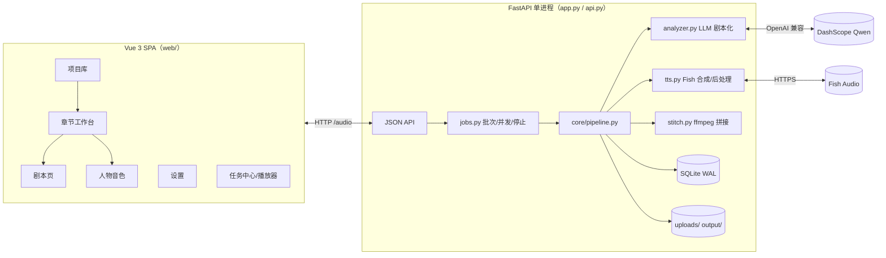
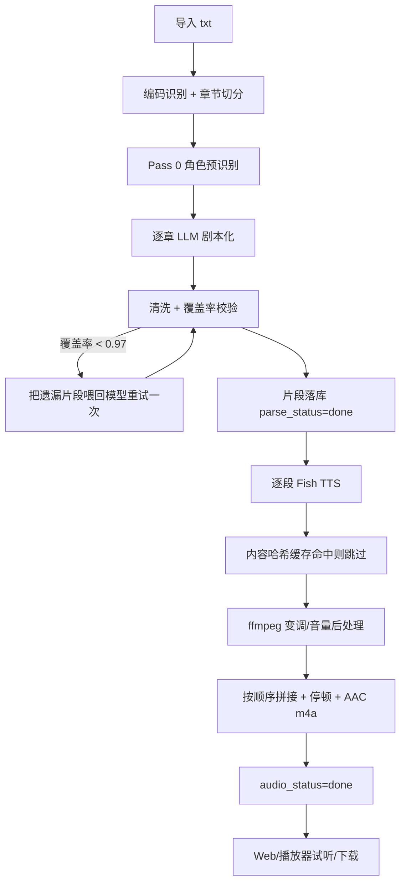
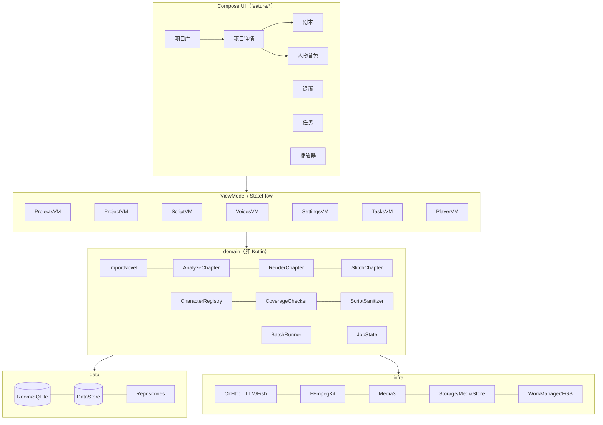
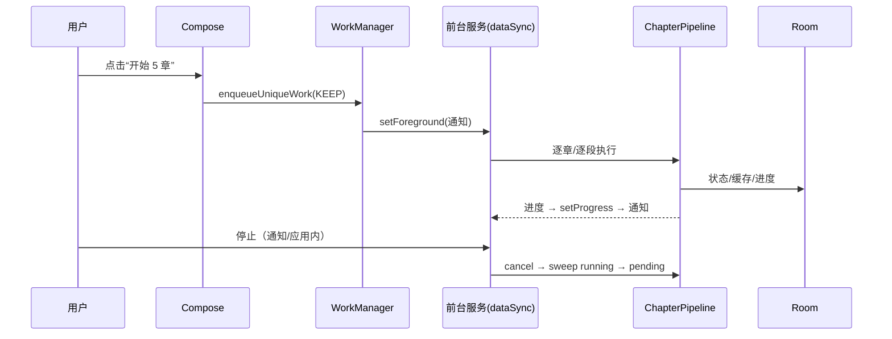

# StoryForge → Android：全量勘探与可行性验证报告

> **对象**：[EstimateFaster/storyforge](https://github.com/EstimateFaster/storyforge)（`main@f1d262b`，2026-09-10）
> **目标**：原生 Android 重构（Jetpack Compose / Material 3 Expressive），APK 只由 GitHub Actions 构建
> **报告日期**：2026-11-08
> **结论**：**架构可行；编译/打包级已在本地 Linux 实编验证（AGP 9.5.1 + Kotlin 2.2.10 + material3 1.5.0-rc01 + ffmpeg AAR 全链路通过），剩余真机运行、后台存活与音频质量需 Phase 0/真机阶段验证**。
> 本文所有“已验证”都注明证据；所有“待验证”都给出可执行的通过标准，不把推断写成事实。

**阅读顺序**：只看结论 → §0 / §9；要拍板 → §7；要排期 → §6；技术细节 → §2–§5；要复现验证 → §8.H。

---

## 目录

- [0. 结论先行](#0-结论先行)
- [1. 勘探范围与方法](#1-勘探范围与方法)
- [2. 现有系统全貌](#2-现有系统全貌)
- [3. 目标 Android 架构](#3-目标-android-架构)
- [4. 模块级移植矩阵](#4-模块级移植矩阵)
- [5. 可行性验证](#5-可行性验证)
- [6. 实施计划](#6-实施计划)
- [7. 需要拍板的决策](#7-需要拍板的决策)
- [8. 附录](#8-附录)
- [9. 结论（给决策者的版本）](#9-结论给决策者的版本)

---

## 0. 结论先行

| 维度 | 可行性 | 关键依据 | 主要残余风险 |
|---|---|---|---|
| 原生重构（非套壳） | ✅ 高 | 现有系统是 3k 行 Python 核心 + 3.5k 行 Vue，业务边界清晰；可逐层映射到 Kotlin/Compose | 无架构级阻塞 |
| 章节导入 / LLM 剧本化 | ✅ 高 | 纯文本、正则、HTTP JSON；Android 完全具备 | `difflib` 覆盖率算法需移植/替代；Java 正则语义差异 |
| Fish Audio TTS | ✅ 高 | 直连 HTTPS，无 CORS；返回 MP3/WAV/PCM | 移动网络抖动、限流、密钥安全 |
| 音频后处理 / 章节拼接 | ✅ 高（有前置验证） | `dev.ffmpegkit-maintained:ffmpeg-kit-audio:8.1.9` 已核实存在，含 `atempo/asetrate/anullsrc/volume/concat`、AAC 编码器、MP4 muxer，16 KB 对齐 | 第三方 fork 供应链；AAR 集成需 CI 验证；APK 体积 |
| 后台长任务 | ⚠️ 中高 | WorkManager 长任务 + `dataSync` 前台服务；模型就是“分批 + 断点续传” | Android 15+ **6 小时/24 小时**前台服务上限；国产 ROM 杀后台；通知权限 |
| Material 3 Expressive UI | ✅ 高（需接受预发布） | `material3 1.5.0-rc01` 已发布 Expressive API；要求 `compileSdk 37`、AGP ≥ 9.1 | 预发布 API 变动；1.5.0 稳定版尚未发布 |
| GitHub Actions 出 APK | ✅ 高 | 账号下已有“无本地 SDK、纯 Actions 构建 + 静态检查”的成熟仓库形态 | 版本矩阵已本地实编通过；CI 上需复验 |
| 工作量 | — | 约 8–12k 行 Kotlin + 3–4k 行测试 | 单人 6–8 周；含设备调优与 CI 迭代 |

**一句话判断**：这不是“能不能做”的问题。版本矩阵与 ffmpeg AAR 已在本地实编打通（§5.1.7）；剩下的是“真机 smoke + 正式工程实现”，是可拆解、可验收的工程量。

**建议的下一步**：把已验证的探针工程落到正式仓库 + GitHub Actions（约 0.5–1 天），然后花 1 天做真机 smoke（FFmpeg `-version`、Room 读写、WorkManager 锁屏），再开始 P1/P2。

---

## 1. 勘探范围与方法

### 1.1 范围

- **代码**：仓库全部 77 个文件（1.1 MB），逐文件通读：
  - 后端 5,972 行 Python（含 tests/tools；核心 `core/` 约 2,000 行）
  - 前端 3,488 行 Vue/JS（5 个视图、4 个 store、14 个组件）
  - `README.md`、`REVIEW.md`（一次全量审查，含实测性能数据）
  - 部署脚本、CLI、运维脚本
- **现状数据**：`storyforge.db` 36 MB / 4,029 章 / 811 片段（审查报告实测）；单书 2,451 章的极端案例；TTS 并发实测曲线（4→2.0 段/秒、8→3.9、12→6.1、16→7.0、20→5.6）。
- **测试**：86 项 pytest；覆盖清洗正则、覆盖率、缓存键、音色池契约、事务、上传安全、参数边界、鉴权。
- **前端**：项目库、章节工作台、剧本页、人物音色、设置、任务中心、全局播放器、登录遮罩。

### 1.2 方法

1. **逐文件静态阅读**：从 `config.py` 到 `api.py`，再到 Vue 视图/Store，建立“UI 动作 → API → 流水线 → 文件/DB”的完整链路。
2. **产物级验证**（不是只看文档）：
   - 下载 `ffmpeg-kit-audio-8.1.9.aar`，解包检查 `jni/arm64-v8a`、`AndroidManifest.xml`、`proguard.txt`、`res/raw/license*`；
   - `readelf -lW` 验证 ELF `LOAD` 段 `Align = 0x4000`（16 KB）；
   - `strings` 验证 `atempo / asetrate / anullsrc / volume / concat / AAC encoder / mp4`；
   - 下载 `material3 1.5.0-rc01` / `ui 1.12.1` / `work-runtime 2.12.0` AAR，读取 `aar-metadata.properties`，确认 `minCompileSdk`、`minAndroidGradlePluginVersion`、`minSdk`；
   - 查询 Google Maven / Maven Central 元数据，确认版本真实存在。
3. **官方文档核对**：Material 3 release notes、AGP 9.5 兼容性、内置 Kotlin、WorkManager 长任务、前台服务类型与超时、Google Play target SDK 要求。
4. **Fish Audio SDK 核对**：解包 `fish-audio-sdk 1.1.0`，确认 `format ∈ {wav, pcm, mp3}`、`prosody.speed/volume`、`reference_id`、`normalize`、`mp3_bitrate`。
5. **既有工程实践对照**：账号下已有一个“无本地 Android SDK、GitHub Actions 构建 Compose APK、静态检查 + 产物校验”的私有仓库；其工作流形态可直接复用（见 §3.12）。

### 1.3 明确没有做的事

- **没有构建最终 App**：本轮只在临时 Linux 环境构建了最小探针（JDK 17 + SDK 37.0 + Gradle 9.9.0），用于验证工具链与 ffmpeg AAR（结果见 §5.1.7）；正式 App 的 APK 仍只由 GitHub Actions 产出。
- **没有在真机/模拟器上安装运行**：后台限制、OEM 行为、音频质量、性能都只能给验证方案，不能给“已通过”。
- **没有调用真实 LLM / Fish API**：不消耗用户额度；网络层行为按代码与官方文档推演。

> 因此，本报告的“可行性”分为两层：**架构与依赖可行性（本报告已验证）**、**编译与运行可行性（Phase 0 / 真机阶段验证）**。两者不要混为一谈。

---

## 2. 现有系统全貌

### 2.1 架构



关键事实：

- **单进程是硬约束**：`jobs._runs`、TTS 信号量、登录失败计数都在内存；`app.py` 固定 `workers=1`。Android 上不存在这个约束，但“进程内任务状态”这一设计需要换成 **DB + WorkManager**。
- **无服务端任务队列**：批次状态只存在于 `jobs.py` 的 dict；进程崩溃后靠 lifespan 把 `running` 复位为 `pending`。Android 必须把“运行中”持久化，否则杀进程后 UI 会出现假进行中。
- **音频与数据库都在本地文件系统**：`output/audio/{novel_id}/...`、`uploads/`、`storyforge.db`。Android 要换成 app 私有目录 + MediaStore 导出。
- **前端是纯 SPA**：没有 SSR、没有 WebSocket，只有 HTTP JSON + `/audio/*` 文件流。去掉 HTTP 层后，业务逻辑可以直接变成 Kotlin 的 Repository/UseCase。

### 2.2 数据模型

| 表 | 关键列 | 说明 |
|---|---|---|
| `novels` | `id, title UNIQUE, file_path` | 项目；标题唯一 |
| `chapters` | `id, novel_id, idx, title, raw_text, parse_status, parse_error, audio_status, audio_error, parse_warn` | `UNIQUE(novel_id, idx)`；`raw_text` 很大，列表查询必须避开 |
| `characters` | `id, novel_id, role_id, name, gender, importance, aliases_json, note, category, voice_id, speed, locked` | `UNIQUE(novel_id, role_id)`；音色锁定 |
| `segments` | `id, chapter_id, seq, type, role_id, emotion, text, status, audio_path, duration_ms, error_msg, tts_key, updated_at` | `UNIQUE(chapter_id, seq)`；片段级状态机 |
| `settings` | `key, value, note` | 全局运行时设置 |
| `character_tuning` | `novel_id, role_id, key, value` | 每角色语速/音量/音调覆盖 |
| `novel_meta` | `novel_id, last_generated_chapter` | “上次生成到第几章”，用于默认下一批 |

索引：`segments(role_id)`、`segments(status)`、`chapters(novel_id, audio_status)`。审查报告实测：1578 章列表查询从 553 ms 优化到 11.6 ms（聚合 SQL），这是 Android 上必须保留的经验。

### 2.3 端到端流程与状态机



状态值统一为 `pending / running / done / error`：

- `chapters.parse_status`、`chapters.audio_status` 独立；
- `segments.status` 独立；
- 批次停止/崩溃后，`*_status=running` 会被 sweep 回 `pending`；
- 解析告警写在 `chapters.parse_warn`（覆盖率、说话人未识别、JSON 降级、输出截断）。

### 2.4 必须逐字保留的核心契约

这些是“换语言后最容易悄悄变味”的部分。移植时应视为**协议**，不是实现细节。

#### 2.4.1 提示词

- `PROMPT`：约 **1,882 字符**，包含 8 组规则、2 个特殊子规则（3.1/3.2、4.1/4.2）、音色池、情绪列表、严格 JSON 格式。
- `PASS0_PROMPT`：约 **476 字符**，角色预识别 + 选角 + “成年后形象”规则。
- `REPAIR_HINT`：覆盖率不足时追加，要求补回遗漏原文。
- 这些中文提示词**不能翻译、不能改写**；一改，LLM 的切分/说话人/选角行为就会变。Android 端应把它们放在 `assets/prompts/*.txt` 或常量对象中，并加“内容哈希”快照测试，防止误改。

#### 2.4.2 音色池

- **63 个类别**（`VOICE_POOL`），类别 id 是数据库/代码的锁定契约，永远不改名。
- 1 个类别带建议语速：`male_brother = 1.15`。
- 8 个类别带 `note`（只给 UI 看，**绝不喂给 LLM**）。
- 旁白类别 `narrator_male` 默认**不分配给角色**（`pool_for_llm(include_narrator=False)`）。
- 兜底映射：男主 → `male_lead_steady`；男配 → `male_gentle_young`；龙套 → `male_young_support`；女主 → `female_lead_gentle`；女配 → `female_young`；女龙套 → `female_mature`。
- 63 个 `voice_id` 是 Fish Audio 的 `reference_id`，不能改。

> Android 端建议**从 Python 源生成 Kotlin 常量**（一次性脚本），而不是手抄 63 条；并用测试锁定 63 个 key 与 voice_id 的映射。

#### 2.4.3 情绪

11 个：`neutral, happy, sad, angry, anxious, excited, surprised, soft tone, serious, calm, whispering`。

TTS 前缀映射 10 个（`neutral` 不加前缀）：

```
[happy] [sad] [angry] [anxious] [excited] [surprised] [soft tone] [serious] [calm] [whispering]
```

#### 2.4.4 TTS 缓存键

Python 唯一口径：

```python
sha1(json.dumps({
  "t": text, "e": emotion, "v": voice_id or "",
  "s": speed, "vol": volume, "p": pitch,
  "m": model
}, sort_keys=True, ensure_ascii=False)).hexdigest()[:12]
```

实测向量：

```
输入: text="你好。", emotion="happy", voice_id="voice1",
      speed=1.0, volume=1.0, pitch=0.0, model="s2.1-pro-free"
规范 JSON: {"e": "happy", "m": "s2.1-pro-free", "p": 0.0, "s": 1.0, "t": "你好。", "v": "voice1", "vol": 1.0}
缓存键: 958a4f29d7e2
```

Android 端如果**不要求与服务器缓存互认**，可以定义 v2 键（推荐加版本前缀，避免以后改口径时迁移困难）。如果要求“把服务器数据搬到手机继续用”，则必须逐字节复刻 Python 的 JSON 序列化（空格、浮点格式、`ensure_ascii=False`）。这是一个明确的取舍点，见 §7。

#### 2.4.5 覆盖率

- 对原文与剧本拼接文本做归一化（去掉空白与引号），用 `difflib.SequenceMatcher(autojunk=False)` 求 `delete/replace` 片段。
- 过滤“设计内会被剥掉”的引导语/短残渣，得到有效缺失；覆盖率 = `1 - 缺失字符数 / 原文长度`。
- 默认阈值 `0.97`；低于阈值把缺失片段喂回模型重试一次，取覆盖率更高的版本。
- 实测：正常章节 98.7%–100%；丢了动作描写的章节 95.7%。

Android 替代方案：
1. 移植 Python `SequenceMatcher`（约 200–300 行，行为最接近）；
2. 用 `java-diff-utils` / `diff-match-patch` 求 diff，再按同样规则过滤；
3. 自己实现 Myers diff（O((N+M)D)），只保留删除区间。

建议：**先用 1 或 2，配 Python 生成的黄金向量**；不要用“字符集合交集”这类近似算法，否则覆盖率告警会失真。

#### 2.4.6 清洗规则

`_strip_speech_tail` / `_split_mixed` / `_find_quoted` / `_split_long` 是决定“谁在念哪句话”的核心：

- 三层迭代剥离引导语：`_SPEECH_TAIL`（说话动词）、`_SPEECH_SINGLE`（单字动词）、`_SPEECH_MOD`（副词残渣）；
- 完整动作描写（“他轻轻一笑。”“递出了自己的卡，”“眉头一皱，”）不能误剥；
- 单字动词必须带修饰词，避免误伤“知道”“正道”；
- 混合段拆成“旁白 + 台词”，纯引导语丢弃；
- 同一句台词不能在旁白和对话里各读一遍；
- 相邻旁白合并上限 = `segment_max_chars`；超长段按句末标点切分，单句超长硬切。

实测样例（可直接作为 Kotlin 测试向量）：

| 输入 | 输出 |
|---|---|
| `他淡淡道：` | `""` |
| `阿甲吃惊道。` | `阿甲` |
| `他轻轻一笑。` | `他轻轻一笑。` |
| `递出了自己的卡，` | `递出了自己的卡，` |
| `知道` | `知道` |
| `他猛地站起，怒道` | `他猛地站起` |
| `_split_long("第一句。第二句。第三句。", 8)` | `["第一句。第二句。", "第三句。"]` |

#### 2.4.7 拼接规则

- 对白后接旁白：`narrator_silence_ms`（默认 350 ms）——注意变量名和语义有点反直觉，实际是“对白 → 旁白”的短停顿；
- 其余相邻片段：`paragraph_silence_ms`（默认 700 ms）；
- 44.1 kHz 单声道，AAC 96 kbps，`+faststart`；
- 输出 `chapter_NNN.m4a`。

### 2.5 HTTP API 面（需要映射成 Android 的用例，而不是照搬）

| 组 | 端点 | Android 对应 |
|---|---|---|
| 项目 | `GET/POST /api/projects`、`PATCH/DELETE /api/projects/{nid}` | `ProjectRepository` + `ImportNovelUseCase` |
| 项目进度 | `GET /api/status`、`GET /api/projects/{nid}/progress` | `JobRepository` StateFlow + Room Flow（**不再轮询**） |
| 章节 | `GET /api/projects/{nid}/chapters`、`GET /api/chapters/{cid}` | `ChapterRepository` / PagingSource |
| 任务 | `POST /api/projects/{nid}/start`、`/stop`、`POST /api/chapters/{cid}/parse`、`/render` | `BatchRunner` / WorkManager |
| 片段 | `PATCH /api/segments/{id}`、`POST /api/segments/{id}/regen` | `SegmentRepository` + `RegenerateSegmentUseCase` |
| 人物 | `GET /api/projects/{nid}/characters`、`PATCH /api/characters/{id}` | `CharacterRepository` / `ChangeVoiceUseCase` |
| 设置 | `GET/PUT /api/settings`、`PUT /api/projects/{nid}/char-tunings`、`POST /api/settings/preview` | `SettingsRepository`（DataStore）+ `VoicePreviewUseCase` |
| 音频 | `GET /audio/seg/{id}`、`/audio/chapter/{cid}`、`/audio/pool/{cat}`、`/audio/preview/{name}` | 本地 `File` + Media3；不再有 HTTP 文件路由 |
| 鉴权 | `/api/login|logout|auth/state` | **删除**；可选生物识别应用锁 |

共 **29 个路由**（含 auth）。Android 端不是“实现 29 个端点”，而是把每个路由背后的**用例**抽出来。建议保留一份 `docs/api-to-usecase.md` 映射表，避免漏功能。

### 2.6 Web 信息架构（Android 的参照）

| 页面 | 核心交互 | Android 形态建议 |
|---|---|---|
| 项目库 | 上传/拖拽、重命名、删除、进度卡 | 项目列表 + FAB 导入 + 长按菜单 |
| 章节工作台 | 搜索、状态筛选、批量起止章、单章一键开始、实时进度、错误横幅 | 项目详情 + 筛选 Chip + 批次 BottomSheet + 章节列表 |
| 剧本页 | 逐片段查看/编辑、单击试听、连播、快捷键、告警横幅 | 剧本列表 + 片段编辑 BottomSheet + 播放跟随 |
| 人物音色 | 63 类音色试听、换音色、角色卡 | 角色列表 + 音色库 + 搜索/档位筛选 |
| 设置 | 并发、片段字数、停顿、模型、默认音色/参数、排除角色 | 设置分组 + 滑杆/输入 + 连接测试 |
| 项目设置 | 每角色语速/音量/音调微调 | 角色参数 BottomSheet + 试听 |
| 任务中心 | 多书并行进度、停止 | 任务页 + 前台通知 + 队列（单活跃） |
| 播放器 | 全局单例、进度拖动、上下句 | Media3 MediaSessionService + 迷你播放器/全屏播放器 |
| 登录 | 服务端鉴权 | **不需要**；可选应用锁 |

### 2.7 运维约束（Android 上要消失或替换）

| 现状 | Android 处理 |
|---|---|
| `.env` + `config.py` + `settings` 表三层配置 | DataStore + Keystore；设置页统一入口 |
| 单进程 / `workers=1` | WorkManager 唯一任务 + DB 持久化 |
| `uploads/`、`output/` 相对路径 | app 私有目录 + 相对路径入库；MediaStore 导出 |
| `imageio-ffmpeg` 子进程 | FFmpegKit 异步 API |
| systemd/Caddy/rsync | 不适用；GitHub Releases/Artifact |
| 登录 Cookie / IP 锁定 | 不适用；设备本身就是边界 |
| 2 s / 6 s 轮询 | Room `Flow` + WorkManager 进度 |
| Web 端 200 MB 上传 | SAF 导入，建议 64 MB 上限（可配置） |

### 2.8 代码规模与移植复杂度

| 模块 | 行数（约） | 移植复杂度 | 说明 |
|---|---:|---|---|
| `core/analyzer.py` | 645 | **高** | 提示词 + 清洗正则 + 覆盖率；行为敏感 |
| `api.py` | 616 | 中 | 主要是契约；拆成用例 |
| `core/pipeline.py` | 331 | 中高 | 角色注册、解析、TTS 工作池、断点续传 |
| `core/db.py` | 309 | 中 | 表/事务/聚合查询；Room 可覆盖 |
| `core/settings.py` | 265 | 中 | 校验、范围、角色微调、默认值迁移 |
| `core/voices.py` | 261 | 低 | 静态数据；建议生成 Kotlin |
| `core/tts.py` | 210 | 中高 | 缓存键、重试、ffmpeg 后处理、并发闸门 |
| `jobs.py` | 189 | 中高 | 批次、停止、收尾、错误汇总 |
| `auth.py` | 173 | 低 | 不移植 |
| `core/ingest.py` | 66 | 低 | 编码识别 + 章节正则 |
| `core/stitch.py` | 57 | 中 | ffmpeg 参数；Android 可优化 |
| `web/src/**` | 3,488 | 中高 | 需要重新设计，不是 1:1 翻译 |

---

## 3. 目标 Android 架构

### 3.1 设计原则

1. **纯原生、无 WebView、无 Python 服务**；LLM/TTS 由 App 直接调用（BYOK）。
2. **离线优先**：已生成的音频、项目、剧本、角色、设置全部本地可用；只有“解析/合成”需要网络。
3. **分批 + 断点续传**：以 5 章为默认批次，每段/每章落库；任何时候被杀进程都能续。
4. **单一活跃任务**：手机不是服务器；同一时间只跑一本书，其余排队。避免多书并发把网络、CPU、电量打满。
5. **失败可见**：覆盖率不足、说话人未识别、JSON 降级、截断、限流、断网、空间不足，都要有明确 UI，不静默。
6. **平台约束优先**：前台服务 6 小时上限、Doze、OEM 杀后台、scoped storage、通知权限，都是设计输入，不是事后补丁。
7. **可回退**：M3 Expressive 预发布、ffmpeg fork、Kotlin/AGP 矩阵都准备 fallback，不让单点卡死。

**非目标（v1 明确不做）**：
- 不做 WebView 套壳，不做“本地起 Python 服务”；
- 不做服务端多用户/登录/公网部署；
- 不做多本书同时生成（只做队列）；
- 不做“整本 2,451 章一键跑完”；
- 不做用户声音克隆/自定义音色训练；
- 不做在线书城/内容分发；
- 不默认上架 Google Play（先 GitHub Release 侧载）。

### 3.2 目标架构图



### 3.3 技术选型与版本矩阵（2026-11 现状）

> 这些版本来自 Google Maven / Maven Central 的实际元数据与 AAR 元数据，不是凭记忆。

| 组件 | 建议版本 | 依据 / 备注 |
|---|---|---|
| AGP | **9.5.1** | 2026-10 稳定；最高 API 37；最低 Gradle 9.6；JDK 17；Build Tools 36 |
| Gradle | **9.9.0** | 当前稳定；满足 AGP 9.5 最低 9.6 |
| JDK | **17（Temurin）** | AGP 9.5 默认/最低 17；CI 用 17 最稳 |
| Kotlin | **2.2.10（AGP 内置）** | AGP 9.5.1 的 POM 依赖 `kotlin-gradle-plugin 2.2.10`；AGP 9 默认内置 Kotlin，**不要再 apply `org.jetbrains.kotlin.android`** |
| Compose 编译器插件 | **2.2.10** | 必须与 Kotlin 版本一致；`org.jetbrains.kotlin.plugin.compose` |
| Compose BOM | **2026.09.00** | 对应 Compose 1.12.1；material3 默认 1.4.0 |
| Material3 | **1.5.0-rc01（覆盖 BOM）** | Expressive API；要求 `compileSdk 37`、AGP ≥ 9.1；1.5.0 稳定版尚未发布 |
| material3-adaptive-navigation-suite | **1.5.0-rc01** | 底部栏/导航栏自适应 |
| compileSdk | **37** | Compose UI 1.12.1 与 material3 1.5.0-rc01 的 AAR 都要求 `minCompileSdk=37` |
| targetSdk | **36** | Google Play 新应用/更新要求 Android 16（API 36） |
| minSdk | **26** | ffmpeg AAR 最低 24；26 可简化存储/加密/ICU；覆盖 Android 8+ |
| Room | **2.8.5** | KSP2；事务/Flow/Paging |
| KSP | **2.2.10-2.0.2** | 与 Kotlin 2.2.10 对齐；已本地实编通过；**需 `android.disallowKotlinSourceSets=false`** |
| WorkManager | **2.12.0** | 长任务 `setForeground` + `CoroutineWorker` |
| Media3 | **1.11.1** | ExoPlayer / MediaSession / 通知 |
| DataStore | **1.3.0** | 设置与加密密钥密文 |
| Paging | **3.5.3** | 2000+ 章节列表 |
| kotlinx.serialization | **1.9.0** | ⚠️ 1.12.0 依赖 Kotlin 2.4 metadata，2.2.10 编译器读不了；1.9.0 兼容 |
| kotlinx.coroutines | **1.11.0** | 结构化并发 |
| OkHttp | **5.5.1** | HTTP/2、超时、取消 |
| FFmpegKit | **8.1.9（`dev.ffmpegkit-maintained:ffmpeg-kit-audio`）** | LGPL-3.0；arm64-v8a + x86_64；minSdk 24；16 KB 对齐 |
| 签名 | GitHub Actions Secrets + `apksigner` | 不把 keystore 提交到仓库 |

**为什么不用 Kotlin 2.4.21？** AGP 9.5.1 内置的是 2.2.10；直接用 2.4.21 需要显式关闭内置 Kotlin（`android.builtInKotlin=false`）并 apply KGP，属于“可做但需要实编验证”的第二种矩阵。第一阶段不要同时赌两个变量。

**为什么 compileSdk 37 而不是 36？** 不是我们想追新，而是 `compose-ui 1.12.1` 和 `material3 1.5.0-rc01` 的 AAR 元数据明确要求 `minCompileSdk=37`。如果坚持 compileSdk 36，就必须回退到更老的 Compose BOM（并失去 Expressive），这是一个明确的取舍。

### 3.4 包结构（v1 建议单模块）

```text
app/src/main/java/com/estimatefaster/audioforge/
├── app/                 Application、MainActivity、AppContainer、导航
├── core/
│   ├── model/           Novel、Chapter、Character、Segment、Voice、Emotion、状态枚举
│   ├── ingest/          TextDecoder、ChapterSplitter、NovelImporter
│   ├── script/          PromptTemplates、LlmScriptAnalyzer、ScriptSanitizer、CoverageChecker
│   ├── voice/           VoicePool（63 条，生成）、VoiceSelection
│   ├── tts/             FishTtsClient、TtsCacheKey、TtsSynthesizer、AudioPostProcessor
│   ├── audio/           ChapterStitcher、SilenceGenerator、AudioProbe
│   ├── storage/         AudioStorage、ProjectFiles、ExportManager、StorageMaintenance
│   ├── network/         OkHttpProvider、RetryPolicy、ConnectivityMonitor
│   ├── settings/        SettingsRepository（DataStore）、SecureKeyStore
│   └── util/            Diff、Regex、Time、Log
├── data/
│   ├── db/              AppDatabase、Entities、DAOs、Migrations
│   └── repository/      ProjectRepository、ChapterRepository、CharacterRepository、JobRepository
├── domain/
│   ├── pipeline/        ChapterPipeline、CharacterRegistry、AnalyzeChapter、RenderChapter
│   ├── jobs/            BatchRunner、GenerationWorker、JobQueue、SweepRunning
│   └── usecase/         StartBatch、StopBatch、UpdateSegment、ChangeVoice、ExportChapter...
├── ui/
│   ├── theme/           Color、Type、Shape、Motion、Theme
│   ├── components/      StatusPill、RoleAvatar、ProgressRing、Waveform、EmptyState...
│   └── navigation/      Routes、NavHost、AdaptiveScaffold
└── feature/
    ├── projects/  project/  script/  voices/  settings/  tasks/  player/  onboarding/
```

**为什么 v1 不拆 10 个 Gradle 模块？** CI-only 迭代下，模块化会显著增加构建配置与反馈时间；先用包边界约束，等核心链路稳定后再拆 `:core:*` / `:feature:*`。单模块不等于“没有架构”，关键是不让 UI 直接碰 DAO/HTTP。

### 3.5 Android 数据模型（Room）

建议 schema（v1）：

```text
novels(
  id INTEGER PK AUTOINCREMENT,
  title TEXT NOT NULL UNIQUE,
  source_name TEXT NOT NULL,          -- 原始文件名
  source_rel_path TEXT NOT NULL,      -- imports/xxx.txt（相对 filesDir）
  char_count INTEGER NOT NULL,
  created_at INTEGER NOT NULL,
  last_opened_at INTEGER
)

chapters(
  id INTEGER PK,
  novel_id INTEGER NOT NULL FK→novels ON DELETE CASCADE,
  idx INTEGER NOT NULL,
  title TEXT NOT NULL,
  raw_text TEXT NOT NULL,
  parse_status TEXT NOT NULL DEFAULT 'pending',
  parse_error TEXT,
  audio_status TEXT NOT NULL DEFAULT 'pending',
  audio_error TEXT,
  parse_warn TEXT,
  seg_count INTEGER NOT NULL DEFAULT 0,   -- 冗余计数，避免列表聚合
  seg_done INTEGER NOT NULL DEFAULT 0,
  UNIQUE(novel_id, idx)
)

characters(
  id INTEGER PK,
  novel_id INTEGER NOT NULL FK→novels ON DELETE CASCADE,
  role_id TEXT NOT NULL,                   -- role_0001 或 narrator
  name TEXT NOT NULL,
  gender TEXT NOT NULL,
  importance TEXT NOT NULL,
  aliases_json TEXT NOT NULL DEFAULT '[]',
  note TEXT NOT NULL DEFAULT '',
  category TEXT NOT NULL,
  voice_id TEXT NOT NULL,
  speed REAL,
  locked INTEGER NOT NULL DEFAULT 1,
  UNIQUE(novel_id, role_id)
)

segments(
  id INTEGER PK,
  chapter_id INTEGER NOT NULL FK→chapters ON DELETE CASCADE,
  seq INTEGER NOT NULL,
  type TEXT NOT NULL,                      -- narration / dialogue
  role_id TEXT NOT NULL,                   -- narrator / role_XXXX
  emotion TEXT NOT NULL,
  text TEXT NOT NULL,
  status TEXT NOT NULL DEFAULT 'pending',
  audio_rel_path TEXT,                     -- 相对 filesDir，不存绝对路径
  duration_ms INTEGER,
  error_msg TEXT,
  tts_key TEXT,
  updated_at INTEGER NOT NULL,
  UNIQUE(chapter_id, seq)
)

character_tuning(novel_id, role_id, key, value, PK(novel_id, role_id, key))
novel_meta(novel_id PK, last_generated_chapter INTEGER NOT NULL DEFAULT 0)
jobs(id, novel_id, mode, status, requested_ids_json, current_chapter_id,
     started_at, finished_at, last_error, stats_json)
```

关键改动：

- **不存绝对路径**：Android 应用目录在备份/恢复/迁移后可能变化；存相对路径，运行时拼 `filesDir`。
- **冗余 `seg_count/seg_done`**：列表页不 JOIN 聚合；每次片段状态变化在事务里维护。审查报告的 553 ms → 11.6 ms 就是这个问题。
- **`jobs` 表**：Web 只把批次放内存；Android 必须持久化，杀进程后 UI 仍能看到“上次批次失败/完成”。
- **`source_rel_path`**：导入时把 SAF 流复制到 app 私有目录，避免 URI 权限过期。
- **外键 + 级联删除**：Room 默认不启用外键，需要 `PRAGMA foreign_keys=ON`（Room 的 `RoomDatabase` 支持 openHelper callback）。删除项目时一个事务删干净，再删文件。

**设置放哪？** 建议全局设置用 **DataStore Preferences**（类型安全、Flow、无 DB 写放大）；项目级角色微调放 Room（与角色同生命周期）。API Key 不落 DataStore 明文，放 Keystore 加密后的密文。这样比 Web 的 `settings` 表更符合 Android 习惯。

### 3.6 状态与并发模型

- **UI 状态**：`StateFlow<UiState>`；Room `Flow` 作为单一事实源；Job 进度用 `StateFlow`。
- **不再 2 秒轮询**：列表/进度由 Room invalidation 驱动；WorkManager 进度用 `setProgress` + 前台通知；UI 只订阅。
- **调度器**：网络/文件/ffmpeg → `Dispatchers.IO`；清洗/覆盖率/diff → `Dispatchers.Default`；UI → Main。
- **并发**：
  - LLM：默认 1（可 1–4），避免免费档限流；
  - TTS：默认 4（可 1–8），全局 `Semaphore`；移动网络下自适应降到 1–2；
  - ffmpeg：同一时间 1 个章节拼接，避免 CPU/内存峰值；
  - 批次：同一时间 1 本书。
- **取消**：`ensureActive()` 在每段/每章循环；OkHttp `Call.cancel()`；FFmpegKit `cancel(sessionId)`；WorkManager `isStopped`。
- **错误分类**：`Transient`（网络/429/5xx/超时）重试；`Permanent`（401/402/400/参数/空间不足）立即失败并给可操作提示；`Partial`（某段失败）保留已完成段，章节标 error，可重试。

### 3.7 后台执行模型（Android 的关键差异）



**必须实现的平台适配**：

1. **WorkManager 长任务**：`CoroutineWorker` + `setForeground(ForegroundInfo(...))`；manifest 合并 `SystemForegroundService` 的 `android:foregroundServiceType="dataSync"`；声明 `FOREGROUND_SERVICE_DATA_SYNC`。
2. **6 小时/24 小时上限**：Android 15+ 对 `dataSync`/`mediaProcessing` 限制为 6 小时/24 小时，且同一类型的所有前台服务共享额度；用户把 App 切到前台会重置计时。策略：
   - 默认批次 5 章，上限 20 章；
   - 每段/每章 checkpoint；到达软上限（如 5 小时）主动收尾，提示“下一批继续”；
   - 处理 `Service.onTimeout`（若用自管 Service）或 WorkManager 的 `isStopped` 收尾；
   - 不做“整本 2451 章一键跑”。
3. **通知权限**：Android 13+ `POST_NOTIFICATIONS`；引导页申请；被拒绝时仍可运行，但要在应用内提示“通知不可见”。
4. **从后台启动限制**：Android 12+ 不允许从后台启动前台服务；只允许用户在前台点击“开始”时入队。
5. **Doze/省电**：前台服务通常不受 Doze 网络限制，但 OEM 可能杀进程；提供“电池优化白名单”引导（`ACTION_REQUEST_IGNORE_BATTERY_OPTIMIZATIONS`），并说明风险。
6. **唤醒锁**：ffmpeg/网络循环期间持有 `PARTIAL_WAKE_LOCK`（带超时），结束释放；不要常驻。
7. **电量/温度**：`PowerManager.isPowerSaveMode`、`isThermalStatus`（API 29+）、`BatteryManager`；低电量/严重热时降并发或暂停（设置可配）。
8. **网络约束**：`NetworkType.CONNECTED`；可选 `UNMETERED`（仅 Wi-Fi）；断网时 WorkManager 暂停，恢复后续传。
9. **进程死亡/重启**：WorkManager 持久化；App 启动时 `sweepRunning()` 把 `running` 复位 `pending`；`jobs` 表保留上次结果。
10. **国产 ROM**：Honor/EMUI、MIUI、ColorOS 对后台限制更激进；必须在真实设备上做“锁屏 30 分钟 / 省电模式 / 清理后台”测试；提供“保持前台通知”“电池白名单”说明。

#### 3.7.1 规模、耗时与存储估算（决定“为什么必须分批”）

按现有实测口径粗算（64 kbps MP3 片段 ≈ 8 KB/s，96 kbps AAC 成品 ≈ 12 KB/s；每章约 30 段、每段约 5 s、成品约 3–5 分钟）：

| 规模 | TTS 请求数 | 片段缓存 | 成品 m4a | 仅 TTS 时间（2–4 段/s） | LLM 解析（1 并发，10–30 s/章） |
|---|---:|---:|---:|---:|---:|
| 5 章 | ~150 | ~6 MB | ~10–18 MB | 40–75 s | 1–3 min |
| 50 章 | ~1,500 | ~60 MB | ~100–180 MB | 6–13 min | 8–25 min |
| 500 章 | ~15,000 | ~600 MB | ~1.0–1.8 GB | 1–2 h | 1.5–4 h |
| 2,451 章 | ~73,000 | ~2.9 GB | ~5–9 GB | 5–10 h | 7–20 h |

结论：

- **6 小时/24 小时的前台服务上限不是理论问题**，2,451 章的书一定会撞上；默认 5 章、上限 20 章是合理设计。
- **存储必须管理**：片段缓存 + 成品可能到 10 GB 级；要有“成品保留、片段缓存 N 天后清理/仅保留成品”的策略。
- **LLM 解析往往比 TTS 更慢**：免费档 1 并发时，500 章要 1.5–4 小时；UI 必须显示“当前第几章/共几章”，不能只有一个转圈。
- **费用按字符/请求计**：开始前显示“预计 N 段 / 约 X MB / N 次 API 调用”，让用户确认，避免误点整本。

### 3.8 音频管线

**方案 A（推荐）：FFmpegKit，复用现有命令语义**

- 变调/音量后处理：

```bash
ffmpeg -y -i seg.mp3 -af "asetrate=44100*f,aresample=44100,atempo=1/f,volume=v" -b:a 64k out.mp3
```

- 静音：`anullsrc=r=44100:cl=mono -t <ms> -b:a 64k sil.mp3`（需要 LAME；所以选 `audio` 变体）。
- 拼接：`-f concat -safe 0 -i list.txt -ar 44100 -ac 1 -c:a aac -b:a 96k -movflags +faststart out.m4a`。
- **Android 优化**：Web 版本先生成中间 WAV（30 分钟章节约 158 MB），再转 AAC；Android 可直接从 concat demuxer 编码 AAC，省掉中间文件与一次 I/O。需要在 Phase 0 用同一批片段对比时长/响度，确认无差异后再启用；保留 WAV 回退。
- **路径安全**：用项目 id/章节序号命名目录与文件（ASCII），用户标题只进 DB/导出名；避免中文/引号导致 concat 列表转义问题。
- **原子写**：`.tmp` → rename；`.hash` 只在文件真实存在且成功后写；失败保留原文件（Web 的 P0-5 教训）。
- **磁盘预检**：开始前估算 `段数 × 平均大小 + 成品大小`，低于阈值直接拒绝并提示清理。

**方案 B（回退）：纯 Android 媒体栈**

- MP3 解码：`MediaExtractor` + `MediaCodec`；
- 变调/变速：Media3 `SonicAudioProcessor`（Sonic 库，支持独立 pitch/speed）；
- AAC 编码 + MP4 封装：`MediaCodec` + `MediaMuxer`；
- 拼接：按 PCM 顺序写入，静音用零样本；或 Media3 `Transformer` 的 `Composition`。
- 代价：代码量更大、设备兼容性要逐台验证；但**不依赖第三方 native AAR**，APK 更小。
- 结论：作为“ffmpeg fork 不可接受”时的备选，不作为 v1 主路径。

**方案 C（最小依赖）：Fish 直接返回 WAV/PCM**

- Fish SDK 确认支持 `format=wav|pcm`。
- 但 PCM/WAV 体积约为 MP3 的 8–10 倍，移动网络/存储不划算；只适合“先下载再本地处理”的 Wi-Fi 场景。
- 不作为默认，作为诊断/极限兼容选项。

### 3.9 网络层

- **OkHttp**：连接池、HTTP/2、`callTimeout`、`connectTimeout`、`readTimeout`；LLM 600 s，TTS 120 s（connect 10 s）。
- **重试**：
  - LLM：最多 6 次；网络/超时/429/500/503；指数退避 + 抖动；`finish_reason=length` 不重试，直接报“章节过长/输出截断”；
  - TTS：最多 4 次；网络/超时/429/503；尊重 `Retry-After`；401/402/400 不重试；
  - 每次重试记录到 `jobs.stats_json`，诊断页可见。
- **自适应并发**：初始 2；连续成功且 p95 低于阈值 → +1，直到上限 8；出现 429/超时 → 减半并冷却 60 s。移动网络/弱网下比固定 12 更稳。
- **计量网络**：默认“合成/下载仅 Wi-Fi”可开；蜂窝下弹确认并估算流量；`NetworkCapabilities.NET_CAPABILITY_NOT_METERED`。
- **连接测试**：设置页提供“测试 LLM / 测试 Fish”按钮；LLM 用极小请求，Fish 用 2 字短句；失败给出 HTTP 状态与可操作提示。
- **密钥**：只放请求头；不写日志；日志中对 `Authorization` 做脱敏；`HttpLoggingInterceptor` 仅 debug 且 redact。

#### 3.9.1 LLM 提供商兼容性

现有代码虽然叫“OpenAI 兼容”，但用了两个**非标准字段**：

- `"thinking": {"type": "disabled"}`（DashScope/Qwen 扩展）；
- `"response_format": {"type": "json_object"}`（OpenAI 标准，但并非所有兼容实现都支持）。

Android 端建议：

- 把 `thinking` 做成“提供商高级选项”，默认自动（DashScope 域名才发）；
- `response_format` 失败（400/422）时，自动去掉该字段重试一次，并在提示词里加强“只输出 JSON”；
- 允许用户配置 `LLM_BASE_URL`、`LLM_MODEL`、`LLM_API_KEY`，默认值保持 `qwen3.7-flash`；
- 不支持流式（现有实现非流式），避免移动端长连接管理复杂化；
- 解析失败/截断/非法 JSON 都要落 `parse_warn`，并在 UI 显示具体原因。

### 3.10 安全与隐私

- **API Key 存储**：Android Keystore 生成 AES-256-GCM 密钥；密文存 DataStore；UI 只显示末 4 位；支持清除/替换；`FLAG_SECURE` 可选用于密钥页。
- **备份**：`android:allowBackup="false"` + `dataExtractionRules`（API 31+）排除密钥/DB；音频太大也不适合云备份。
- **网络**：`usesCleartextTraffic=false`；仅 HTTPS；不默认做证书 pinning（Fish/DashScope 证书轮换会导致全量失败），如需要可做“可选严格模式”。
- **文件**：不申请 `MANAGE_EXTERNAL_STORAGE`；SAF 导入、MediaStore 导出、FileProvider 分享；导出文件名做非法字符替换。
- **输入校验**：片段文本 ≤ 2000 字；角色必须属于当前项目；情绪必须在 11 个枚举内；章节/项目标题长度限制；上传大小上限。
- **日志**：不记录原文全文、密钥、完整响应体；记录 `novelId/chapterId/segmentId`、状态、耗时、错误码；诊断日志可导出/清除。
- **第三方**：ffmpeg LGPL 声明；Fish/LLM 服务条款由用户承担；小说版权由用户负责；隐私政策说明“文本会发送到用户配置的 LLM/TTS 服务”。

### 3.11 UI / UX（Material 3 Expressive）

**设计定位**：不是把 Web 工作台缩小，而是“随身有声书工作台”：
- 80% 的使用是“看进度、试听、改一句、继续生成”；
- 重操作（导入、批量、换音色）用 BottomSheet/全屏对话框，不堆在首屏；
- 所有长任务都有“现在在做什么、还剩多少、能不能停”。

**主题**：
- `MaterialExpressiveTheme`（1.5.0-rc01；若 API 名变化，用 `materialExpressiveTheme` 包装层隔离）；
- `MotionScheme.expressive()`；
- 品牌色延续 Web 的靛蓝主色 + 音频琥珀强调色；支持动态取色（Android 12+）与浅/深/跟随系统；
- 中文排版：系统字体，正文 15–16sp、行高 1.8–1.9；章节标题用 M3 `headlineSmall`；避免过度字重。

**组件使用（Expressive 只用在“有情绪”的地方）**：
- `LargeFlexibleTopAppBar`：项目详情，滚动折叠；
- `ButtonGroup`：模式选择（解析+生成 / 仅解析 / 仅生成）；
- `SplitButton`：开始/停止；
- `FloatingActionButtonMenu`：导入/新建；
- `LoadingIndicator` / `WavyProgressIndicator`：长任务；
- `HorizontalFloatingToolbar`：剧本页的播放/编辑/重生成；
- `FilterChip`：章节状态筛选；
- `ListItem`（Expressive）：章节/音色列表；
- `ModalBottomSheet`：编辑片段、换音色、批次设置；
- `Snackbar`：轻提示；`AlertDialog`：删除/重新解析等破坏性操作；
- `NavigationSuiteScaffold`：手机底部栏、平板 NavigationRail。

**导航**：
- 底部三栏：项目 / 任务 / 设置；
- 项目详情、剧本、人物、项目设置、播放器为二级；
- 迷你播放器悬浮在底部导航之上；点击进入全屏播放器；
- 预测式返回（`enableOnBackInvokedCallback=true`）。

**屏幕清单（v1）**：

| 屏幕 | 关键内容 | 验收要点 |
|---|---|---|
| Onboarding | 欢迎、API Key、连接测试、通知权限、电池白名单说明 | 无 Key 也能浏览；有 Key 才能开始 |
| 项目库 | 搜索/排序、进度环、导入 FAB、长按菜单 | 2000 章项目也能快速滚动 |
| 导入 | SAF 选择、编码检测、章节预览、重名处理 | 失败有原因；不覆盖已有项目 |
| 项目详情 | 头部进度、批次控制、筛选、章节列表、人物条 | 批次默认 5 章；开始前有估算/确认 |
| 剧本 | 片段卡、角色/情绪/状态、播放、编辑、告警 | 播放跟随；编辑只影响该段 |
| 人物音色 | 角色卡、当前音色、试听、换音色、音色库 | 63 类可搜索/筛选；换音色提示重生成 |
| 设置 | Key、模型、并发、停顿、默认音色、存储、主题、诊断 | 改完即生效；校验范围 |
| 任务 | 当前批次、进度、ETA、停止、历史/错误 | 切页/锁屏不丢状态 |
| 播放器 | 全屏、队列、进度、倍速、定时关闭、上下章 | 后台播放/蓝牙/音频焦点 |
| 存储 | 各项目占用、清理孤儿、导出/删除 | 删除前确认；显示释放量 |

**无障碍**：
- 48dp 最小触控；`contentDescription`；标题 `heading()`；进度 `liveRegion`；
- TalkBack 能完成“导入→开始→停止→播放”；
- 字体放大 200% 不截断关键按钮；
- 对比度 ≥ 4.5:1；深色模式单独校验；
- 尊重“移除动画”系统设置。

### 3.12 构建与 CI（只走 GitHub Actions）

**工作流形态**（与账号下既有 Android 仓库一致）：

```yaml
name: Android CI
on:
  push: { branches: [main] }
  pull_request:
  workflow_dispatch:

permissions: { contents: read }

jobs:
  build:
    runs-on: ubuntu-latest
    timeout-minutes: 40
    steps:
      - uses: actions/checkout@v4

      - uses: actions/setup-java@v4
        with: { distribution: temurin, java-version: '17' }

      - uses: android-actions/setup-android@v3
      - name: Install SDK 37
        run: sdkmanager "platforms;android-37.0" "build-tools;37.0.0" "platform-tools"

      - uses: gradle/actions/setup-gradle@v4

      - name: Unit tests + lint + debug APK
        run: ./gradlew --no-daemon --stacktrace lintDebug testDebugUnitTest assembleDebug

      - name: Verify APK (badging / 16KB / signature)
        run: |
          BT=$ANDROID_SDK_ROOT/build-tools/37.0.0
          APK=app/build/outputs/apk/debug/app-debug.apk
          $BT/aapt2 dump badging "$APK" | head -20
          $BT/zipalign -c -P 16 -v 4 "$APK"
          $BT/apksigner verify --verbose "$APK"

      - uses: actions/upload-artifact@v4
        with:
          name: audioforge-debug-apk
          path: app/build/outputs/apk/debug/*.apk
          if-no-files-found: error
```

**Release job（tag 触发）**：

- 从 Secrets 解码 keystore：`KEYSTORE_BASE64 / KEYSTORE_PASSWORD / KEY_ALIAS / KEY_PASSWORD`；
- `assembleRelease`（`minifyEnabled=false` 起步，R8 后续再开）；
- `apksigner verify`、`zipalign -c -P 16`、`aapt2 dump badging`；
- 上传 APK + `mapping.txt`（若开 R8）+ `checksums.txt`；
- 创建 GitHub Release，附 ABI split（arm64-v8a、x86_64）与 universal APK。

**CI 静态检查（可选但推荐）**：
- `ktlint` / `detekt`；
- Gradle `verification-metadata.xml` 锁定依赖校验和（尤其是 ffmpeg AAR）；
- `./gradlew dependencies` 检查冲突；
- 源码级检查脚本（如“禁止在 Composable 里直接 new OkHttp”“禁止把 Key 写进 BuildConfig”）。

**构建时间预期**：首次 10–15 分钟（下载 Gradle/AGP/AAR），缓存后 5–8 分钟。ffmpeg AAR 21 MB，不会显著拖慢。

---

## 4. 模块级移植矩阵

| 现有文件 | Android 目标 | 移植方式 | 测试 | 风险 |
|---|---|---|---|---|
| `config.py` | `core/settings` + `BuildConfig` | 去掉 `.env`；默认值/范围常量 | 设置校验单测 | 默认值口径要一致 |
| `core/ingest.py` | `core/ingest/TextDecoder` + `ChapterSplitter` | ICU 编码检测；Java 正则（Unicode） | 与 Python 同输入同输出 | 编码/正则差异 |
| `core/analyzer.py` | `core/script/*` | 提示词逐字迁移；清洗正则逐条迁移；覆盖率替代实现 | 黄金向量 + 原 20+ 用例 | **最高**：正则/覆盖率 |
| `core/voices.py` | `core/voice/VoicePool` | 从 Python 生成 Kotlin 常量 | 63 key/voice_id/note/speed 快照 | 手抄出错 |
| `core/tts.py` | `core/tts/*` | OkHttp + FFmpegKit；缓存键 v2 或兼容 | 缓存键/重试/后处理 | 键口径/并发 |
| `core/stitch.py` | `core/audio/ChapterStitcher` | FFmpegKit 异步；直接 AAC 优化 | 时长/顺序/静音/可播放 | ffmpeg 集成 |
| `core/db.py` | `data/db/*` | Room entities/DAO；事务；冗余计数 | Room + 迁移测试 | SQL/事务语义 |
| `core/settings.py` | `core/settings` + DataStore | 全局设置 DataStore；角色微调 Room | 范围/默认/迁移 | 三层配置简化 |
| `core/paths.py` | `core/storage/AudioStorage` | 相对路径 + filesDir；导出 MediaStore | 路径/清理/导出 | scoped storage |
| `core/log.py` | `core/util/AppLogger` | Logcat + 文件；脱敏 | 日志不泄密 | 隐私 |
| `core/pipeline.py` | `domain/pipeline/*` | 角色注册、解析、TTS 工作池、断点续传 | 假客户端集成测试 | 状态机 |
| `jobs.py` | `domain/jobs/*` | WorkManager + `jobs` 表；单活跃 | WorkManager TestDriver | 6h/进程死亡 |
| `api.py` | `domain/usecase/*` | 拆用例；不实现 HTTP | ViewModel/用例测试 | 漏功能 |
| `auth.py` | 删除 | 可选生物识别应用锁 | — | 无 |
| `app.py` | `MainActivity` / `AppContainer` | 单 Activity + Compose | 启动测试 | 初始化顺序 |
| `web/**` | `ui/**` + `feature/**` | 重新设计，不 1:1 翻译 | Compose UI + 截图 | 交互/无障碍 |
| `forge.py` / `run_chapter.py` | 不移植 | 用诊断页/测试替代 | — | 调试入口变少 |
| `migrate_audio.py` / `repair_audio.py` | `StorageMaintenance` | 扫描/修复/孤儿清理 | 单测 | 误删 |
| `tools/voice_audition.py` | 不移植 | 音色库已定稿 63 类 | — | 无 |

### 4.1 必须“逐字保留” vs “可以重写”

**逐字保留（行为契约）**：
- 提示词全文、规则顺序；
- 63 个音色类别/voice_id/label/note/speed；
- 11 个情绪 + Fish 方括号前缀；
- 清洗正则的匹配顺序与词表；
- 覆盖率阈值/补写策略；
- 缓存键输入集合；
- 章节正则；
- 拼接停顿语义；
- 状态值与告警语义。

**可以重写（平台适配）**：
- HTTP → OkHttp；asyncio → coroutines；SQLite → Room；ffmpeg 子进程 → FFmpegKit；Vue → Compose；轮询 → Flow；`.env` → DataStore/Keystore；多书并行 → 单活跃队列；WAV 中间文件 → 直接 AAC；绝对路径 → 相对路径；服务端鉴权 → 无。

### 4.2 关键算法移植细节

#### 4.2.1 正则

- Python `re` 默认 Unicode `\s`；Java/Kotlin `Regex` 默认 ASCII `\s`。必须加 `Pattern.UNICODE_CHARACTER_CLASS`（Kotlin：`RegexOption.UNICODE_CASE` 不够，需 `Pattern.compile(..., Pattern.UNICODE_CHARACTER_CLASS)` 或 `Regex(pattern, setOf(...))` 的底层 flag）。
- Python `$` 与 Java `$` 在末尾换行上的行为略有差异；清洗输入通常已 `strip()`，但仍建议用 `\z`/显式边界测试。
- Python `str.strip(chars)` 与 Kotlin `trim { it in chars }` 语义接近，但要对全角/半角引号逐字符核对。
- `_find_quoted` 依赖字符索引；Kotlin `String` 是 UTF-16 code unit，中文 BMP 无问题；emoji 可能拆半，建议用 `codePoints` 或接受风险。
- **性能**：复杂交替 + 可选组在长段落上可能回溯。测试 10k/20k 字段落；必要时把 `(?:...)?` 改为 possessive/原子组，或先按句切分再清洗。
- **测试**：把 Python `tests/test_analyzer.py` 的 20+ 断言逐条搬成 Kotlin 参数化测试；再加 100 条真实章节的“输入→输出”快照（脱敏）。

#### 4.2.2 覆盖率

推荐实现顺序：
1. 先移植一个**只求删除区间**的 diff（Myers 或 `java-diff-utils`），用 Python 对同一批文本生成 `(coverage, missing)` 期望；
2. 把 `_is_expected_drop` / `_strip_speech_tail` 原样移植，过滤设计内丢失；
3. 断言覆盖率误差 ≤ 0.001，且缺失片段包含关键短语；
4. 若误差不可接受，再移植 Python `SequenceMatcher` 的完整算法（`find_longest_match` + `get_matching_blocks` + `get_opcodes`）。

不要用“字符集合覆盖率”或“最长公共子序列长度 / 总长度”直接替代：前者对重复字不敏感，后者会把顺序错乱当成覆盖。

#### 4.2.3 缓存键

两个选项：

| 选项 | 优点 | 缺点 |
|---|---|---|
| A. 复刻 Python 键 | 可与服务器缓存/数据互认；便于迁移 | 需要精确复刻 JSON 空格/浮点格式；易被“优化”破坏 |
| B. v2 键（推荐） | 实现简单、可读、可版本化；避免跨端格式陷阱 | 不能直接复用服务器 `.hash`/DB 缓存 |

建议 v2 规范：

```text
"v2|" + sha1(
  "e=" + emotion + "\n" +
  "m=" + model + "\n" +
  "p=" + pitch + "\n" +
  "s=" + speed + "\n" +
  "t=" + text + "\n" +
  "v=" + voiceId + "\n" +
  "vol=" + volume
).hex().take(12)
```

浮点统一用 `BigDecimal`/`toPlainString`（或固定 6 位小数去尾零），避免 `1.0E-4`。若以后要导入服务器数据，再加 `LegacyCacheKey` 读取旧 `.hash`。

#### 4.2.4 编码识别

- 优先 `android.icu.text.CharsetDetector`（API 24+）：`detect()` → `detectedCharset.name`；覆盖 UTF-8/UTF-16/GB18030/Big5。
- 回退顺序：BOM（UTF-16LE/BE）→ UTF-8（严格 decode）→ GB18030 → Big5；用 `CharsetDecoder` + `CodingErrorAction.REPORT` 判断“能否严格解码”。
- CJK 占比校验（前 20k 字符中 `\u4e00-\u9fff` > 15%），与 Python 一致；不满足则让用户手动选编码。
- 读文件大小上限：建议 64 MB（Web 是 200 MB）；超过直接拒绝并提示“建议先在电脑切分/压缩”。

#### 4.2.5 ffmpeg

- 用 `FFmpegKit.executeAsync(command, session -> ...)`；`suspendCancellableCoroutine` 包装；`FFmpegKit.cancel(sessionId)` 支持取消。
- 不要在主线程 `execute()`；不要并发跑多个 ffmpeg。
- 检查 `ReturnCode.isSuccess`；失败时把 `session.getFailStackTrace()`/`getOutput()` 末尾 800 字符写入错误，但 UI 只显示可读摘要。
- 输入/输出用 app 私有 ASCII 路径；concat 列表里对单引号做 `'\''` 转义（虽然路径是 ASCII，仍建议）。
- 先做 Phase 0 的“命令等价性”验证：同一组 MP3，在服务器（imageio-ffmpeg）与 Android（FFmpegKit）各跑一次，比较：
  - 总时长误差 < 100 ms；
  - 顺序/停顿位置正确；
  - 可被 Media3/系统播放器播放；
  - 文件大小/码率在预期范围；
  - 变调后基频变化方向正确（可用简单 FFT 或人耳）。

### 4.3 Android 特有流程修改（相对 Web）

| Web 行为 | Android 行为 | 原因 |
|---|---|---|
| 上传到服务器 `uploads/` | SAF 导入 + 复制到 app 私有目录 | 无服务器；URI 权限会过期 |
| 服务端持有 Key | 用户输入，Keystore 加密 | BYOK；不把 Key 放进 APK |
| 多书并行任务 | 单活跃 + 队列 | 手机网络/CPU/电量/前台服务限制 |
| 默认整本/上次+5 章 | 默认 5 章，上限 20 章 | 6 小时 FGS 上限、成本、失败恢复 |
| TTS 并发 12 | 默认 4，自适应 1–8 | 移动网络与服务端限流 |
| 2 s / 6 s 轮询 | Room Flow + WorkManager 进度 | 省电、实时性更好 |
| 任务状态在内存 | `jobs` 表 + WorkManager | 进程死亡/重启可恢复 |
| 绝对路径 `output/...` | 相对路径 + `filesDir`；导出 MediaStore | 应用目录可变；scoped storage |
| 中间 WAV 再转 AAC | 直接 concat → AAC（验证后） | 省 100+ MB 临时空间 |
| `<audio>` 单例 | Media3 `MediaSessionService` | 后台播放、音频焦点、蓝牙 |
| 键盘快捷键 J/K/空格/E | 手势/长按/无障碍操作 | 触屏 |
| 表格 + 分页 | LazyColumn + Paging 3 | 手机屏幕 |
| Toast + 模态框 | Snackbar + BottomSheet | M3/触屏习惯 |
| 服务端登录 | 无；可选生物识别应用锁 | 设备即边界 |
| 全量 63 音色样音在服务器 | 按需合成并缓存 | 仓库不含样音；减小 APK |
| 清理孤儿音频 | 存储页 + 自动清理 | 手机空间敏感 |

---

## 5. 可行性验证

### 5.1 已验证（有证据）

#### 5.1.1 FFmpeg 在 Android 上有可用、合规、可集成的产物

- 原 `com.arthenica:ffmpeg-kit-*` 于 2025-01-06 退役，2025-04-01 从 Maven Central 移除。
- 维护分支 `dev.ffmpegkit-maintained:ffmpeg-kit-audio:8.1.9` 在 Maven Central 存在（POM 200）。
- 下载 AAR（21.5 MB）实测：
  - `jni/arm64-v8a`、`jni/x86_64`；
  - `AndroidManifest.xml` `minSdkVersion=24`；
  - `readelf -lW libavcodec.so` 的 `LOAD` 段 `Align=0x4000`（16 KB）；
  - `strings` 命中 `atempo`、`asetrate`、`anullsrc`、`volume`、`concat`、`AAC encoder`、`mp4a`、`m4a`；
  - `res/raw/license*` 包含 LGPL/第三方许可；`proguard.txt` 保留 JNI 方法。
- ABI：只发布 `arm64-v8a` + `x86_64`，**没有 `armeabi-v7a` / `x86`**；App 应声明只支持 64 位。Google Play 已要求 64 位；侧载时老 32 位设备装不上，需要提前说明。
- 许可：`ffmpeg-kit-audio` 是 **LGPL-3.0**；只使用非 GPL 变体，**不要用 `-full-gpl` / `-gpl`**（会要求整个 App GPL 兼容）。App 内提供“开源许可”页，保留 AAR 自带 `license*` 资源。
- 结论：**音频后处理/拼接不需要自己编 NDK**。代价是第三方 fork 的供应链与 APK 体积。

> 如果这个 fork 不可接受，回退方案见 §5.4。

#### 5.1.2 Material 3 Expressive 可用，但要求 compileSdk 37

- `material3 1.5.0-rc01` 于 2026-11-04 发布；1.5.0 稳定版尚未发布。
- 1.4.0（2025-09-24）的 release notes 明确：所有 `ExperimentalMaterial3ExpressiveApi` API 在 1.4.0-beta01 被移除，要体验 Expressive 需 1.5.0-alpha。
- AAR 元数据：`material3 1.5.0-rc01` → `minCompileSdk=37`、`minAndroidGradlePluginVersion=9.1.0`；`compose-ui 1.12.1` 同样 `minCompileSdk=37`。
- 结论：**要用 Expressive，就必须 compileSdk 37 + AGP ≥ 9.1**；这不是可选优化，是硬门槛。

#### 5.1.3 前台服务上限与 WorkManager 形态

- Android 15+ 对 `dataSync`/`mediaProcessing` 前台服务：**6 小时/24 小时**，同类型共享；用户切前台会重置；`Service.onTimeout` 后几秒内必须 `stopSelf()`。
- Android 14+ 需要 `FOREGROUND_SERVICE_DATA_SYNC` 权限与 `android:foregroundServiceType="dataSync"`。
- WorkManager 2.12.0 的 `SystemForegroundService` 需要在 App manifest 里 `tools:node="merge"` 声明类型；`setForeground(ForegroundInfo(..., FOREGROUND_SERVICE_TYPE_DATA_SYNC))`。
- 结论：**不能设计“整本 2451 章一键后台跑”**；必须分批 + checkpoint + 用户可恢复。这与现有“5 章一批”的默认行为天然一致。

#### 5.1.4 目标 SDK 与 16 KB

- Google Play：新应用/更新需 target Android 16（API 36）或更高。
- 16 KB 页面对齐对 targetSdk 35+ 是硬要求；ffmpeg AAR 已对齐（实测 0x4000）。
- 结论：targetSdk 36、compileSdk 37、`zipalign -c -P 16` 校验，是正确组合。

#### 5.1.5 Fish Audio 的输入/输出形态

- SDK schema：`format ∈ {wav, pcm, mp3}`、`mp3_bitrate ∈ {64,128,192}`、`reference_id`、`normalize`、`prosody.speed/volume`、`sample_rate` 可选。
- 现有代码用 `mp3/64k/normalize=true/prosody.speed`，Android 可原样请求。
- **注意**：上游代码注释明确“Fish 的 `prosody.pitch` / `prosody.volume` 实测不生效，且 `normalize=true` 会归一化音量”，所以 Android 仍要用 ffmpeg 本地做 pitch/volume；不要以为 SDK schema 里有 volume 就能交给服务端。
- 结论：TTS 客户端没有平台阻塞；PCM/WAV 还可作为 ffmpeg 的回退输入。

#### 5.1.6 GitHub Actions 构建链可行

- 账号下已有仓库采用“`ubuntu-latest` + `setup-java 17` + `./gradlew assembleRelease` + 静态检查 + `upload-artifact`”的形态；说明 runner/权限/产物链路可用。
- AGP 9.5 要求 Gradle ≥ 9.6、JDK 17、Build Tools 36；仓库可提交 Gradle wrapper（9.9.0），CI 不需要本地安装 Gradle。
- 结论：**正式 APK 不需要本地构建**；本地 VM 可用于快速编译/单测，最终仍以 CI 产物为准。代价是 CI 回合较慢，需要静态检查前置。

#### 5.1.7 本地 Linux 实编验证（2026-11-08，已通过）

为了不把“编译级未知”留到计划里，本轮额外在临时 Linux 环境做了一次**最小可编译工程**验证（不是最终 App，只验证工具链）：

- 环境：OpenJDK 17.0.2、Android SDK Platform `android-37.0`、Build Tools `37.0.0`、Gradle 9.9.0、AGP 9.5.1、Kotlin 2.2.10（AGP 内置）、Compose BOM 2026.09.00、material3 1.5.0-rc01、Room 2.8.5 + KSP 2.2.10-2.0.2、WorkManager 2.12.0、Media3 1.11.1、FFmpegKit 8.1.9。
- 工程包含：`MaterialExpressiveTheme` + `MotionScheme.expressive()` + `LoadingIndicator`、一个 Room Entity/DAO/Database、一个 `CoroutineWorker`、`SystemForegroundService` manifest 合并、FFmpegKit AAR、OkHttp/DataStore/Paging 依赖。
- 结果：
  - `assembleDebug` **成功**，universal APK 约 **63 MB**；
  - `assembleRelease` **成功**，universal APK 约 **58 MB**（`isMinifyEnabled=false`），用测试 keystore 签名后 `apksigner verify` 通过（v2 scheme）；
  - `zipalign -c -P 16` 对 debug/release 均 **通过**；
  - APK 只含 `arm64-v8a` + `x86_64` 的 native libs（设置 `abiFilters` 后），无 32 位残留；
  - `aapt2 dump badging`：`minSdk=26`、`targetSdk=36`、`compileSdk=37`；
  - 合并后的 manifest：`SystemForegroundService` 的 `foregroundServiceType=0x1`（dataSync）；
  - 打包出的 `libavcodec.so` 仍是 `Align=0x4000`（16 KB）；
  - `MaterialExpressiveTheme` / `MotionScheme.expressive()` / `LoadingIndicator` 编译通过（需要 `@OptIn(ExperimentalMaterial3ExpressiveApi::class)`）。
- 实编发现（已写入 Phase 0 坐标与 §5.2/§5.4）：
  1. **KSP 2.2.10-2.0.2 + AGP 9 内置 Kotlin 必须加 `android.disallowKotlinSourceSets=false`**，否则配置阶段报 “Using kotlin.sourceSets DSL to add Kotlin sources is not allowed with built-in Kotlin”。这是当前组合的硬要求，不是可选项。
  2. **`kotlinx-serialization-json 1.12.0` 不能与 Kotlin 2.2.10 同用**：它依赖 Kotlin 2.4.10 的 stdlib/metadata，编译器报 “binary version of its metadata is 2.4.0, expected 2.2.0”。改用 **1.9.0**（依赖 stdlib 2.2.0）后编译通过。
  3. **`platforms;android-37` 不存在**；SDK 包名是 `platforms;android-37.0`，`compileSdk = 37` 会解析到 `platforms/android-37.0`。
  4. **Expressive 组件是实验 API**：`MaterialExpressiveTheme`、`MotionScheme.expressive()`、`LoadingIndicator` 都要 `@OptIn(ExperimentalMaterial3ExpressiveApi::class)`；后续每个使用点都要显式 opt-in，不能靠模块级开关。
  5. **APK 体积**：不混淆 + 双 ABI 的 universal release 约 58 MB；若在意体积，用 ABI split（arm64 单包约 30–35 MB）或 `ffmpeg-kit-min` + 改静音格式（不推荐，见 §5.1.1 的 LAME 依赖）。
- 仍未验证（不要误读为“已通过”）：FFmpeg 在真实 Android 上执行、Room 运行时读写、WorkManager 真机后台、Media3 播放、UI 交互、真实 LLM/Fish 请求、音频质量。这些是 P0 后段与真机阶段的事。

> 基于本报告的正式执行计划见 [android-execution-plan.md](android-execution-plan.md)。

### 5.2 待验证/已部分通过（Phase 0）

| # | 验证项 | 通过标准 | 失败时回退 |
|---|---|---|---|
| V1 ✅ | AGP 9.5.1 + 内置 Kotlin 2.2.10 + Compose 插件 2.2.10；Gradle 9.9.0 | `assembleDebug` 成功；无 “kotlin-android plugin” 冲突 | Gradle 降到 9.6.x/9.7.x；关闭 `android.builtInKotlin`，改用 KGP 2.2.21 + 插件 2.2.21 |
| V2 ✅ | `material3 1.5.0-rc01` + Compose BOM 2026.09.00 + compileSdk 37；Compose 编译器 2.2.10 与 runtime 1.12.1 的兼容性 | 编译通过；`MaterialExpressiveTheme`/`MotionScheme.expressive()` 可用；无 “Compose Compiler requires …” | 先试 KGP 2.2.21 + Compose 插件 2.2.21；再不行用 KGP 2.4.21（KSP 2.3.13）；最后降到 material3 1.4.0 / 更老 BOM（放弃 Expressive） |
| V3 ✅ | KSP 2.2.10-2.0.2 + Room 2.8.5 | Room 代码生成成功；单测通过 | 用 KAPT（`com.android.legacy-kapt`）或 SQLDelight/raw SQLite |
| V4 ✅（打包） | ffmpeg-kit AAR 在 AGP 9.5 下集成 | 依赖解析成功；APK 内含 arm64/x86_64 原生库；16 KB 校验通过；`-version` 真机执行待 V6 | 换 `ffmpeg-kit-min` + 改静音格式；或 Media3/Sonic 方案；或 CI 自编 FFmpeg |
| V5 ✅（构建/签名） | release 构建与签名 | `assembleRelease` 成功；`apksigner verify` 通过；安装启动/JNI 待真机 | v1 关闭 minify；只保留 debug/release 不混淆 |
| V6 | WorkManager 前台服务 | 锁屏 30 分钟任务继续；通知可见；停止可收尾 | 自管 `ForegroundService` + `START_STICKY` |
| V7 | 覆盖率/清洗黄金向量 | Kotlin 输出与 Python 逐条一致或覆盖率误差 ≤ 0.001 | 移植完整 `SequenceMatcher` |
| V8 | 真机后台 | Honor/EMUI、MIUI、ColorOS 至少各 1 台：锁屏/省电/清理后台后能续传 | 引导电池白名单；缩短批次；前台提醒 |

#### Phase 0 最小依赖坐标（探针直接复制）

```kotlin
// app/build.gradle.kts
android {
    namespace = "com.estimatefaster.audioforge"
    compileSdk = 37
    defaultConfig {
        applicationId = "com.estimatefaster.audioforge"
        minSdk = 26
        targetSdk = 36
        versionCode = 1
        versionName = "0.1.0"
    }
    compileOptions {
        sourceCompatibility = JavaVersion.VERSION_17
        targetCompatibility = JavaVersion.VERSION_17
    }
    kotlin { compilerOptions { jvmTarget.set(JvmTarget.JVM_17) } } // 若内置 Kotlin 暴露的是 android.kotlinOptions，按 AGP 9 DSL 调整
}

dependencies {
    implementation(platform("androidx.compose:compose-bom:2026.09.00"))
    implementation("androidx.compose.ui:ui")
    implementation("androidx.compose.ui:ui-tooling-preview")
    implementation("androidx.compose.material3:material3:1.5.0-rc01") // 覆盖 BOM
    implementation("androidx.compose.material3:material3-adaptive-navigation-suite:1.5.0-rc01")
    implementation("androidx.activity:activity-compose:1.13.0")
    implementation("androidx.lifecycle:lifecycle-runtime-compose:2.11.0")
    implementation("androidx.navigation:navigation-compose:2.10.2")
    implementation("androidx.room:room-runtime:2.8.5")
    implementation("androidx.room:room-ktx:2.8.5")
    ksp("androidx.room:room-compiler:2.8.5")
    implementation("androidx.work:work-runtime-ktx:2.12.0")
    implementation("androidx.media3:media3-exoplayer:1.11.1")
    implementation("androidx.media3:media3-session:1.11.1")
    implementation("androidx.datastore:datastore-preferences:1.3.0")
    implementation("androidx.paging:paging-compose:3.5.3")
    implementation("org.jetbrains.kotlinx:kotlinx-serialization-json:1.9.0")
    implementation("org.jetbrains.kotlinx:kotlinx-coroutines-android:1.11.0")
    implementation("com.squareup.okhttp3:okhttp:5.5.1")
    implementation("dev.ffmpegkit-maintained:ffmpeg-kit-audio:8.1.9")
    debugImplementation("androidx.compose.ui:ui-tooling")
}
```

> 注意 1：AGP 9 默认内置 Kotlin，**不要**再 apply `org.jetbrains.kotlin.android`；Compose 插件用 `org.jetbrains.kotlin.plugin.compose` 2.2.10，KSP 用 2.2.10-2.0.2。若 V1/V2/V3 失败，按 §5.4 回退，不要在一个构建里同时改多个版本。
>
> 注意 2（实编发现）：KSP 2.2.10-2.0.2 会通过 `kotlin.sourceSets` 注入生成目录，AGP 9 内置 Kotlin 默认禁止，必须在 `gradle.properties` 加 `android.disallowKotlinSourceSets=false`；否则配置阶段直接失败。该开关是官方错误信息给出的临时方案，后续 KSP 升级后可移除。
>
> 注意 3（实编发现）：`platforms;android-37` 不存在，正确包名是 `platforms;android-37.0`；`compileSdk = 37` 会使用 `platforms/android-37.0`。

### 5.3 风险登记表

| ID | 风险 | 概率 | 影响 | 缓解 | 验证 |
|---|---|---|---|---|---|
| R1 | M3 Expressive 预发布 API 变动 | 高 | 中 | 固定 1.5.0-rc01；主题/组件包一层；升级前跑截图/编译 | Phase 0 + 每次升级 |
| R2 | AGP 9.5 / 内置 Kotlin / KSP 矩阵不兼容 | 低（已实编） | 高 | 保留 KSP sourceSets 开关；准备 KGP opt-out 回退 | V1/V3 |
| R3 | ffmpeg fork 供应链/停更 | 中 | 高 | 锁 8.1.9；Gradle 校验和；保留 AAR 备份；准备自编脚本 | V4 + 依赖验证 |
| R4 | ffmpeg AAR 与 AGP 9/R8 不兼容 | 中 | 中 | 先 debug 不混淆；proguard 规则；必要时 fork AAR 补 namespace | V4/V5 |
| R5 | 6 小时 FGS 上限 / OEM 杀后台 | 高 | 高 | 5 章批次、checkpoint、电池白名单、前台通知、恢复入口 | V6/V8 |
| R6 | 覆盖率算法不一致 | 中 | 中 | 黄金向量；误差阈值；完整移植 | V7 |
| R7 | 正则回溯/语义差异 | 中 | 中 | 性能基准；Unicode flag；逐条测试 | V7 + benchmark |
| R8 | 长章节 LLM 输出截断 | 高 | 高 | 明确报错；分块解析（v1.1）；手动拆分 | 真章节测试 |
| R9 | 移动网络限流/断网/费用 | 高 | 中 | 自适应并发；重试；Wi-Fi 默认；估算/确认 | 弱网测试 |
| R10 | 存储爆炸（GB 级音频） | 高 | 中 | 相对路径；直接 AAC；清理；保留策略；空间预检 | 2000 章项目 |
| R11 | API Key 泄露 | 中 | 高 | Keystore 加密；不备份；日志脱敏；不写 BuildConfig | 安全测试 |
| R12 | Compose 大列表性能 | 中 | 中 | Paging 3；稳定 key；避免整表 Flow；基准 | 2000 章滚动 |
| R13 | 音频质量/拼接差异 | 中 | 中 | 同片段 A/B；时长/响度/顺序检查；保留 WAV 回退 | V4/V7 |
| R14 | 导出/scoped storage 兼容 | 中 | 中 | MediaStore + FileProvider；API 26–28 兼容分支 | 多版本设备 |
| R15 | 许可/合规（LGPL、Fish/LLM） | 低 | 中 | 非 GPL 变体；许可页；用户协议/隐私说明 | 发布前审查 |

### 5.4 回退方案（按优先级）

1. **M3 Expressive 不可用/不稳定** → material3 1.4.0 稳定 + 标准 M3 组件；保留主题抽象，等 1.5.0 稳定再切换。功能不受影响，只是少一些 Expressive 动效/组件。
2. **AGP 9.5 + 内置 Kotlin 编不过** → `android.builtInKotlin=false` + KGP 2.2.21 + Compose 插件 2.2.21 + KSP 2.2.21-2.0.5；或降到 AGP 9.4.1。若 Compose runtime 1.12.1 明确要求更高 Kotlin，再试 KGP 2.4.21 + Compose 插件 2.4.21 + KSP 2.3.13（AGP 9.5 的兼容边界需实编确认）。
3. **KSP/Room 编不过** → `com.android.legacy-kapt` + Room compiler；或 raw SQLite（`SQLiteOpenHelper`）手写 DAO。后者的 SQL 可以直接从 Python 迁移，反而更可控。
4. **ffmpeg-kit fork 不可接受** → 
   - **B1**：Media3 Transformer + `SonicAudioProcessor` + `MediaMuxer`（纯平台，代码多）；
   - **B2**：CI 里用 NDK 自编 FFmpeg（30–60 分钟/次，维护成本高）；
   - **B3**：Fish 返回 PCM/WAV，Kotlin 直接拼接 + MediaCodec AAC（体积/网络代价）。
5. **前台服务被 OEM 杀** → 自管 `ForegroundService`（`START_STICKY`）+ 唤醒锁 + 电池白名单引导；WorkManager 作为补充，不作为唯一生命线。
6. **长章节截断** → v1 明确报错 + 手动分段；v1.1 实现按段落窗口分块解析（带 overlap + 覆盖率合并）。

---

## 6. 实施计划

### 6.1 阶段划分

| 阶段 | 内容 | 交付物 | 出口标准 | 预估 |
|---|---|---|---|---|
| **P0 探针** | 私有仓库/分支；Gradle 骨架；Compose + material3 1.5.0-rc01 + ffmpeg AAR + Room + WorkManager；CI | 可安装的 debug APK；CI 绿 | V1–V5 编译/打包/签名通过；APK 能启动；ffmpeg `-version` 在真机/模拟器成功 | 1–2 天 |
| **P1 核心域** | model/ingest/sanitizer/coverage/voice pool/设置校验；黄金向量 | 纯 Kotlin 核心 + 单测 | 原 20+ 清洗用例、6 导入用例、覆盖率/缓存键向量通过 | 3–5 天 |
| **P2 数据与网络** | Room schema/DAO/迁移；DataStore；OkHttp LLM/Fish；TTS 缓存/后处理；ffmpeg 拼接 | 可导入→解析→合成→拼接一条链路 | 真机跑通 1 章；m4a 可播；断点续传 | 4–6 天 |
| **P3 任务系统** | 批次/队列/停止/sweep；WorkManager + FGS + 通知；存储清理 | 5 章批次稳定运行 | 锁屏/杀进程/断网后可续；错误可见 | 3–5 天 |
| **P4 主 UI** | 主题/导航/项目库/项目详情/章节列表/导入/空态/错误态 | 可完成 80% 日常操作 | 2000 章列表流畅；无障碍基本通过 | 5–7 天 |
| **P5 深度 UI** | 剧本编辑/播放跟随；人物音色；设置；任务页；播放器；Onboarding | 功能对齐 Web（除服务端） | 功能矩阵逐项勾选 | 4–6 天 |
| **P6 硬化** | 弱网/低电/低存储/多设备；性能；Release CI/签名/文档 | 可分发 release APK | 验收清单 + 真机矩阵 | 3–5 天 |

**总计**：约 **23–36 个开发日**；加 30% 缓冲 ≈ **6–8 周（单人）**。若只做“最小可用”（P0–P4），约 **3–4 周**。

### 6.2 测试策略

**必须自动化（CI，JVM/无设备）**：
- 清洗/覆盖率/章节切分/缓存键/设置校验/角色映射/路径/错误分类；
- Room DAO + 迁移（Robolectric 或 instrumented，若 CI 不上模拟器则用 Robolectric）；
- WorkManager 逻辑（`TestListenableWorkerBuilder` / `WorkManagerTestInitHelper`）；
- ViewModel 状态（fake repository）；
- Compose 预览/截图（Paparazzi/Roborazzi，可选）。

**必须真机/模拟器（人工或 instrumented）**：
- FFmpegKit 真实执行、Media3 播放、通知、后台、SAF、MediaStore、Keystore；
- 弱网/断网/锁屏/进程死亡/重启/低存储/低电量/热；
- 2000 章项目滚动/内存；
- 音频 A/B（与服务器成品对比）。

**黄金向量**：
- 用 Python 仓库对 `test/sample_novel.txt` 与 5–10 段真实章节生成：章节切分、清洗前后、覆盖率、缓存键、TTS 文本前缀；
- 提交为 JSON fixtures；Kotlin 测试逐条断言；
- 任何“为了让测试过而改期望”的提交都必须单独 review。

### 6.3 验收标准（Definition of Done）

**功能**
- 导入 UTF-8/GBK/UTF-16 txt；自动切章；重名不覆盖。
- 解析一章：角色注册/音色锁定/台词/旁白/情绪/覆盖率告警/补写重试。
- 合成一章：缓存命中跳过；改一句只重合成该段；拼接顺序/停顿正确；m4a 可播放/导出。
- 换角色音色：只重置该角色片段与含该角色的章节。
- 批量 5 章：可停止/恢复；失败章节可见；错误可读。
- 63 音色可试听/搜索/筛选；角色微调可试听。
- 播放器：前后台切换、锁屏、蓝牙、音频焦点、倍速、进度。
- 存储：占用统计、孤儿清理、导出/删除。

**非功能**
- 冷启动 < 2.5 s（中端机）；项目列表 2000 章首帧 < 500 ms；滚动 60 fps。
- 30 分钟章节拼接 < 30 s（中端机）；峰值内存 < 200 MB。
- 锁屏 30 分钟任务不中断（目标设备）；被杀后可恢复。
- 无 ANR/Crash；无明文 Key；日志不泄密。
- TalkBack 完成主流程；字体 200% 不截断；对比度达标。

**CI**
- `lintDebug`、`testDebugUnitTest`、`assembleDebug`、`assembleRelease` 全绿。
- APK 校验：`minSdk/targetSdk` 正确、`zipalign -c -P 16`、签名有效、ABI 符合预期。
- 依赖校验和锁定；无 `SNAPSHOT`/动态版本。

### 6.4 工作量与团队建议

- **单人**：6–8 周（含 CI 迭代、真机调优、文档）。
- **1.5 人**（一人核心/音频，一人 UI）：4–5 周；接口先定，UI 用 fake 数据并行。
- **风险缓冲**：Phase 0 若版本矩阵卡住，预留 2–3 天；ffmpeg 若走自编，额外 3–5 天。

---

## 7. 需要拍板的决策

| # | 决策 | 选项 | 推荐 | 影响 |
|---|---|---|---|---|
| D1 | Material 3 Expressive | A. 1.5.0-rc01 + compileSdk 37；B. 1.4.0 稳定（无 Expressive）；C. 等 1.5.0 稳定 | **A**（符合需求；接受预发布） | 预发布 API/构建门槛 |
| D2 | minSdk | A. 26；B. 24；C. 29 | **A（26）** | 设备覆盖 vs 实现简化 |
| D3 | ABI | A. arm64-v8a + x86_64；B. 仅 arm64 | **A** | APK 体积；模拟器 |
| D4 | 分发 | A. GitHub Artifact/Release + 侧载；B. Google Play | **A（先）** | 前台服务政策/签名/隐私 |
| D5 | Key 模式 | A. BYOK 设备加密；B. 自建 relay | **A** | 安全/成本/是否仍有服务器 |
| D6 | 任务模型 | A. 单活跃 + 队列 + 默认 5 章；B. 多书并行；C. 整本一键 | **A** | 稳定性/电量/费用 |
| D7 | 长章节分块 | A. v1 做；B. v1.1 做，v1 明确报错 | **B**（先保证主链路） | 超长章节成功率 |
| D8 | 服务器数据迁移 | A. v1 做导入；B. 后续 | **B** | 是否要兼容旧数据 |
| D9 | 工程结构 | A. 单模块 + 包边界；B. 多模块 | **A（先）** | CI 速度/可维护性 |
| D10 | DI | A. 手写 AppContainer；B. Hilt | **A** | 构建复杂度 |
| D11 | 音色样音 | A. 按需合成缓存；B. 打包 63 个 MP3 | **A** | APK 体积/离线试听 |
| D12 | 应用标识 | 包名/应用名/仓库名 | 待定 | 签名/发布/品牌 |

**如果只回答三个**：D1（Expressive 预发布是否接受）、D5（是否坚持完全 BYOK/无服务器）、D4（只侧载还是也要上架）。这三个决定会影响架构与 CI 的形态。

---

## 8. 附录

### A. API → 用例映射（建议）

| 用例 | 输入 | 输出/副作用 |
|---|---|---|
| `ImportNovel` | SAF URI / 文件名 | novel + chapters；复制源文件；编码/切章 |
| `StartBatch` | novelId, start, end, mode, force | 入队 WorkManager；`jobs` 行 |
| `StopBatch` | novelId | 取消 Worker；sweep running→pending |
| `AnalyzeChapter` | chapterId, force | segments；parse_status/warn |
| `RenderChapter` | chapterId | segment mp3 + chapter m4a；audio_status |
| `UpdateSegment` | segmentId, roleId, emotion, text | 状态 pending；章节 pending |
| `RegenerateSegment` | segmentId | 只重合成该段 |
| `ChangeVoice` | characterId, category | 角色 voice 更新；相关片段 pending |
| `PreviewVoice` | category/voiceId + params | 试听 mp3（缓存） |
| `ExportChapter` | chapterId | MediaStore/分享 URI |
| `CleanOrphanAudio` | — | 删除无引用文件；统计释放 |
| `TestConnections` | — | LLM/Fish 可用性 |

### B. Room 查询要点

- 项目列表：一条聚合 SQL，按 novel 分组统计 `chapters_total/done`、`seg_total/done`；不要逐项目子查询。
- 章节列表：`ChapterBrief` 投影，不含 `raw_text`；`seg_count/seg_done` 用冗余列；`LIMIT/OFFSET` 或 keyset。
- 进度：Room `Flow` + `distinctUntilChanged`；任务运行中只更新当前章节/片段，避免整表失效。
- 片段状态批量更新：`UPDATE segments SET status=... WHERE id IN (...)` 单事务；不要逐条写。
- 删除项目：一个事务删 segments/chapters/characters/tuning/meta/jobs/novels，再删文件；外键级联 + 显式兜底。

### C. ffmpeg 命令等价清单

```bash
# 1) 变调 + 音量（pitch 半音，volume 倍率）
ffmpeg -y -i seg.mp3 \
  -af "asetrate=44100*2^(pitch/12),aresample=44100,atempo=2^(-pitch/12),volume=volume" \
  -b:a 64k seg.post.mp3

# 2) 静音（350/700ms）
ffmpeg -y -f lavfi -i anullsrc=r=44100:cl=mono -t 0.35 -b:a 64k sil350.mp3

# 3) 拼接 + AAC（Android 优化：直接编码，省 WAV）
ffmpeg -y -f concat -safe 0 -i concat.txt \
  -ar 44100 -ac 1 -c:a aac -b:a 96k -movflags +faststart chapter.m4a

# 4) 旧版：先 WAV 再 AAC（回退）
ffmpeg -y -f concat -safe 0 -i concat.txt -ar 44100 -ac 1 -c:a pcm_s16le _chapter.wav
ffmpeg -y -i _chapter.wav -c:a aac -b:a 96k -movflags +faststart chapter.m4a
```

### D. 黄金向量（Phase 1 直接可用）

> 完整文件：[docs/fixtures/porting-vectors.json](fixtures/porting-vectors.json)（含 63 音色摘要与三段提示词全文）；音色池全量：[docs/fixtures/voice-pool.json](fixtures/voice-pool.json)。

```json
{
  "cache_key": {
    "input": {"text":"你好。","emotion":"happy","voice_id":"voice1","speed":1.0,"volume":1.0,"pitch":0.0,"model":"s2.1-pro-free"},
    "canonical_json": "{\"e\": \"happy\", \"m\": \"s2.1-pro-free\", \"p\": 0.0, \"s\": 1.0, \"t\": \"你好。\", \"v\": \"voice1\", \"vol\": 1.0}",
    "key": "958a4f29d7e2"
  },
  "tts_text": {"text":"你好。","emotion":"soft tone","expect":"[soft tone] 你好。"},
  "strip_speech_tail": [
    ["他淡淡道：", ""],
    ["阿甲吃惊道。", "阿甲"],
    ["他轻轻一笑。", "他轻轻一笑。"],
    ["递出了自己的卡，", "递出了自己的卡，"],
    ["知道", "知道"],
    ["他猛地站起，怒道", "他猛地站起"]
  ],
  "split_long": {"text":"第一句。第二句。第三句。","limit":8,"expect":["第一句。第二句。","第三句。"]},
  "sample_chapters": [
    {"idx":0,"title":"第一章 山边小村","chars":145},
    {"idx":1,"title":"第二章 七玄门","chars":664}
  ]
}
```

### E. 63 音色池摘要

- 旁白 1：`narrator_male`。
- 男主/男配/龙套/反派/老年/上位者/女性/女童/旁白变体等 62 个。
- 带建议语速：`male_brother`（1.15）。
- 带 UI note：`male_lead_warm`、`male_youth_18`、`male_brother`、`male_young_master`、`male_villain_old`、`male_elder_3`、`male_magnetic`、`female_elegant`。
- `note` 不能进 LLM 提示词；`label` 才能进。
- 完整数据以 `core/voices.py` 为准，移植时用脚本生成，不手抄。

### F. 版本矩阵（以 §5.1.7 实编结果为准；复制到 `gradle/libs.versions.toml`）

```toml
[versions]
agp = "9.5.1"
kotlin = "2.2.10"          # AGP 内置；不要 apply kotlin-android
composeBom = "2026.09.00"
material3 = "1.5.0-rc01"
compileSdk = "37"         # SDK 包名是 platforms;android-37.0
targetSdk = "36"
minSdk = "26"
room = "2.8.5"
ksp = "2.2.10-2.0.2"
work = "2.12.0"
media3 = "1.11.1"
datastore = "1.3.0"
paging = "3.5.3"
serialization = "1.9.0"
coroutines = "1.11.0"
okhttp = "5.5.1"
ffmpegKit = "8.1.9"
```

```properties
# gradle.properties（实编必需）
android.disallowKotlinSourceSets=false   # KSP 2.2.10-2.0.2 + AGP 9 内置 Kotlin
android.useAndroidX=true
android.nonTransitiveRClass=true
```

### G. 参考

- [Compose Material 3 release notes](https://developer.android.com/jetpack/androidx/releases/compose-material3)（1.4.0 移除 Expressive API；1.5.0-rc01）
- [AGP 9.5 release notes](https://developer.android.com/build/releases/gradle-plugin)（API 37 / Gradle 9.6 / JDK 17）
- [Migrate to built-in Kotlin](https://developer.android.com/build/migrate-to-built-in-kotlin)
- [Foreground service timeouts](https://developer.android.com/develop/background-work/services/fgs/timeout)（6h/24h）
- [Foreground service types](https://developer.android.com/develop/background-work/services/fgs/service-types)（dataSync/mediaProcessing）
- [WorkManager long-running workers](https://developer.android.com/develop/background-work/background-tasks/persistent/how-to/long-running)
- [Meet Google Play target API level requirement](https://developer.android.com/google/play/requirements/target-sdk)
- [ffmpeg-kit-maintained README](https://github.com/ffmpegkit-maintained/ffmpeg)
- [ffmpeg-kit-audio 8.1.9 POM](https://repo1.maven.org/maven2/dev/ffmpegkit-maintained/ffmpeg-kit-audio/8.1.9/ffmpeg-kit-audio-8.1.9.pom)
- [Compose BOM 2026.09.00 POM](https://dl.google.com/dl/android/maven2/androidx/compose/compose-bom/2026.09.00/compose-bom-2026.09.00.pom)
- [material3-android 1.5.0-rc01 POM/AAR](https://dl.google.com/dl/android/maven2/androidx/compose/material3/material3-android/1.5.0-rc01/material3-android-1.5.0-rc01.pom)
- [Fish Audio SDK schema](https://pypi.org/project/fish-audio-sdk/)
- 上游仓库：[EstimateFaster/storyforge](https://github.com/EstimateFaster/storyforge)

### H. 本次验证命令（可复现）

```bash
# 1) 版本是否存在
curl -s https://dl.google.com/dl/android/maven2/androidx/compose/material3/material3/maven-metadata.xml | tail -20
curl -s https://repo1.maven.org/maven2/dev/ffmpegkit-maintained/ffmpeg-kit-audio/maven-metadata.xml

# 2) AAR 元数据（compileSdk / AGP 下限 / minSdk）
curl -sL -o m3.aar https://dl.google.com/dl/android/maven2/androidx/compose/material3/material3-android/1.5.0-rc01/material3-android-1.5.0-rc01.aar
unzip -p m3.aar META-INF/com/android/build/gradle/aar-metadata.properties
unzip -p m3.aar AndroidManifest.xml | grep -o 'minSdkVersion="[0-9]*"'

# 3) ffmpeg AAR 内容与 16KB 对齐
curl -sL -o ff.aar https://repo1.maven.org/maven2/dev/ffmpegkit-maintained/ffmpeg-kit-audio/8.1.9/ffmpeg-kit-audio-8.1.9.aar
unzip -l ff.aar | grep -E 'jni/|license'
unzip -p ff.aar AndroidManifest.xml | grep -o 'minSdkVersion="[0-9]*"'
unzip -o -q ff.aar 'jni/arm64-v8a/*' -d ff && readelf -lW ff/jni/arm64-v8a/libavcodec.so | grep LOAD
strings ff/jni/arm64-v8a/libavcodec.so ff/jni/arm64-v8a/libavfilter.so |
  grep -E '^(atempo|asetrate|anullsrc|volume|concat)$'

# 4) 本轮实际在临时 Linux 环境做了最小探针实编（结果见 §5.1.7）
#    JDK 17.0.2 / platforms;android-37.0 / build-tools;37.0.0 / Gradle 9.9.0
#    正式 App 的 APK 仍只由 GitHub Actions 产出。
```

---

## 9. 结论（给决策者的版本）

1. **可以重构，且值得重构**：现有系统的业务边界、数据模型、状态机都很清晰；Android 端不需要“翻译 Web”，而是把 `analyze → tts → stitch` 三个纯逻辑层原样搬过去，再用 Compose 重新做交互。
2. **真正的平台难点只有两个**：**后台长任务**（6 小时上限/OEM 杀进程）和**音频栈**（ffmpeg）。前者用“5 章批次 + checkpoint + 前台服务”解决；后者用已验证的 ffmpeg-kit fork 解决，且有 Media3/Sonic 回退。
3. **UI 的唯一硬门槛**是 Material 3 Expressive 目前只有 `1.5.0-rc01`，且要求 `compileSdk 37`。如果接受预发布，这条就通；不接受就退回 1.4.0 稳定版（功能不变，少 Expressive 组件）。
4. **版本矩阵和 ffmpeg AAR 已经实编打通**；接下来不要先写 UI，而是先做 P1/P2 核心链路与真机 smoke（FFmpeg `-version`、Room 读写、WorkManager 锁屏），再进入 P4。这样 UI 不会建立在未验证的运行时假设上。
5. **建议的第一笔投入**：把已验证的探针工程落到正式仓库 + CI（约 0.5–1 天），再花 1 天在真机/模拟器上跑 `ffmpeg -version`、Room 读写、WorkManager 锁屏；这三个 smoke 过了，后面 90% 的不确定性就消失了。
